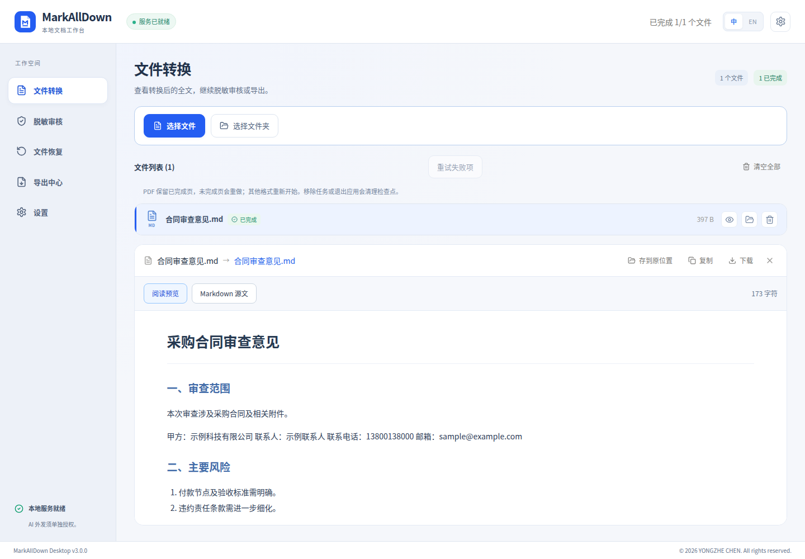
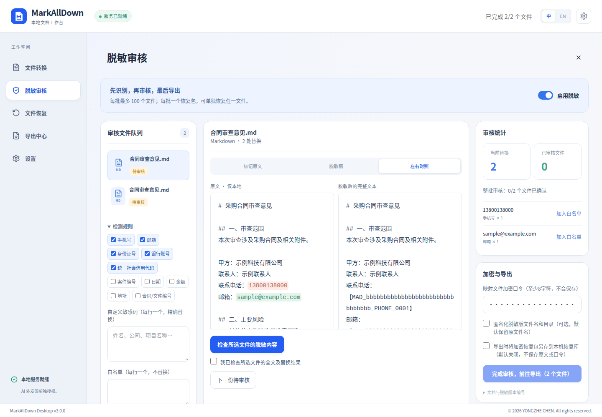
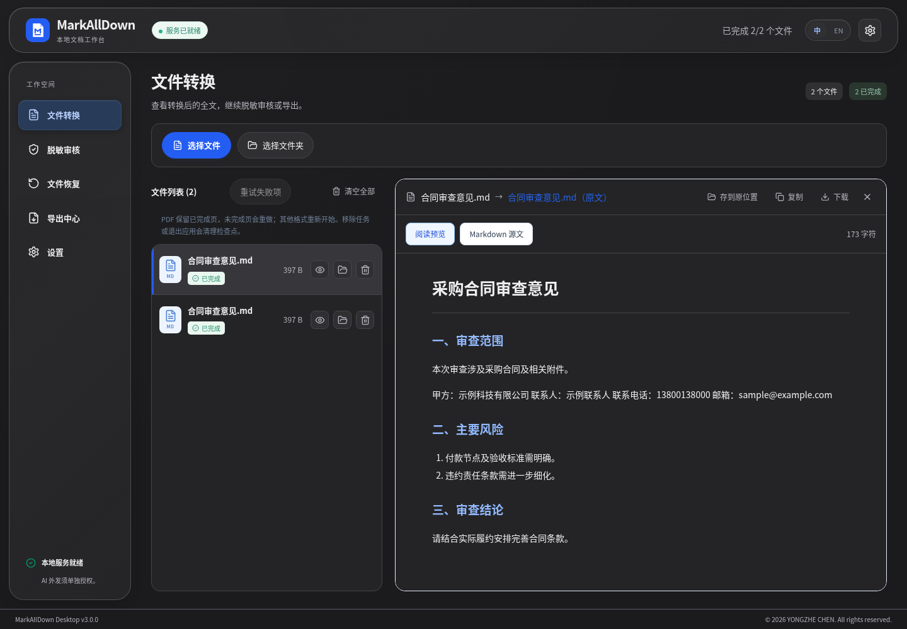

# MarkAllDown

### 把文档变成 Markdown，让内容更易阅读、整理与分享。

本地转换 · 中文 OCR · 脱敏审核 · 加密恢复

[English](README.md) · **简体中文**

**[立即网页试用](https://markalldown-preview.ardentpeach129.chatgpt.site)**　|　**[下载 3.0.0 正式版](https://github.com/TuSiV/markalldown/releases/tag/v3.0.0)**　|　[快速开始](#快速开始)　|　[文档导航](docs/README.md)

Windows · macOS Apple Silicon / Intel · 浏览器 · 中文 / English

---

> 图为真实应用组件使用合成示例文档的验收截图；服务与原生接口使用测试替身。原生安装与真实转换由独立 CI 验证。

## 一个工作台，完成文档处理

| 转换与阅读 | 审核与分享 |
|---|---|
| **多格式转 Markdown** — PDF、Office、图片、HTML 等常见文件，支持旧版 Office 正文提取。 | **全文脱敏审核** — 规则、自定义敏感词与白名单，逐文件对照并确认后导出。 |
| **中文 OCR** — 识别图片与扫描 PDF；文字层 PDF 优先直接提取。 | **加密恢复包** — 使用脱敏 Markdown、独立 JSON 恢复包与口令还原文本。 |
| **桌面批量队列** — 文件夹导入、可调并发、暂缓与继续、失败重试。 | **灵活导出** — 独立文件、合并 Markdown、目录结构或 ZIP。 |
| **浏览器即开即用** — 文件在浏览器中处理，可准备 PDF / OCR 离线资源。 | **双语界面** — 中文 / English 切换保留任务，文件正文和文件名保持原样。 |

<strong>查看脱敏审核与 macOS 深色界面</strong>

### 脱敏审核

### macOS 深色界面

截图使用合成样例及模拟原生偏好；macOS 材质为 Tauri / WebKit 实现，不代表原生 NSGlassEffectView 效果。

## 选择适合你的版本

| | 浏览器版 | 桌面版 |
|---|---|---|
| **开始使用** | [打开网页](https://markalldown-preview.ardentpeach129.chatgpt.site)，无需安装 | 安装 Windows / macOS 应用 |
| **转换位置** | 当前浏览器中的本地处理引擎 | 本机内置转换服务与 OCR |
| **导入与导出** | 文件选择或拖入；下载 Markdown / 资源 ZIP | 文件、文件夹与批量队列；保存到本机目录 |
| **脱敏与恢复** | 全文审核、独立加密恢复包 | 全文审核、独立恢复，另有可选本机加密恢复库 |
| **AI 辅助识别** | 不提供云端 AI | 可选，默认关闭，需明确同意外发脱敏稿 |
| **离线使用** | 提前缓存页面、引擎及 OCR / PDF 资源；缓存可能被浏览器回收 | 安装包内置转换服务与 OCR 模型，无需另装 Python |

桌面和浏览器使用不同引擎，格式支持、资源提取及排版结果可能不同。手机网页需要 HTTPS；当前不提供原生 iOS / Android 安装包。

## 下载桌面版

| 平台 | 安装包 |
|---|---|
| Windows x64 | [EXE 安装程序](https://github.com/TuSiV/markalldown/releases/download/v3.0.0/MarkAllDown_3.0.0_x64-setup.exe) · [MSI 安装程序](https://github.com/TuSiV/markalldown/releases/download/v3.0.0/MarkAllDown_3.0.0_x64_en-US.msi) |
| macOS · Apple Silicon | [ARM64 DMG](https://github.com/TuSiV/markalldown/releases/download/v3.0.0/MarkAllDown_3.0.0_aarch64.dmg) |
| macOS · Intel | [x64 DMG](https://github.com/TuSiV/markalldown/releases/download/v3.0.0/MarkAllDown_3.0.0_x64.dmg) |

[发布说明与全部附件](https://github.com/TuSiV/markalldown/releases/tag/v3.0.0) · [SHA256 校验文件](https://github.com/TuSiV/markalldown/releases/download/v3.0.0/SHA256SUMS.txt) · [历史版本](https://github.com/TuSiV/markalldown/releases)

**安装过 3.0.0 预发布包？** 正式版从统一后的主线重新构建，包含导出选项修复。请重新下载安装，并使用本次发布的新 SHA256 校验文件。

macOS 包使用临时签名，未作 Apple Developer ID 签名或公证；首次打开可能需要在“系统设置 → 隐私与安全性”中允许打开。

## 快速开始

### 转换文件

1. 打开 [网页版](https://markalldown-preview.ardentpeach129.chatgpt.site) 或桌面应用，选择文件；桌面版还可导入文件夹。
2. 等待转换完成，检查阅读预览或 Markdown 源文。
3. 网页版下载结果；桌面版选择保存位置与导出格式。包含提取资源的网页结果以 ZIP 打包。

桌面版启动期间即可选择文件，服务就绪后自动处理。浏览器页眉与桌面设置均可切换中文 / English。

### 分享脱敏稿与恢复文本

1. 进入“脱敏审核”，配置规则、自定义词及白名单，填写至少 8 字符的口令。
2. 检查每份文件的完整原文与脱敏稿，修正误检和漏检后确认审核。
3. 导出脱敏 Markdown，**将加密 JSON 恢复包与正文分开保管**。浏览器版需先保存恢复包并确认，再下载脱敏稿。
4. 恢复时进入“文件恢复”，选择脱敏 Markdown、对应恢复包及口令；检查预览后另存。

## 数据处理与能力边界

- **本地转换**：桌面服务仅监听回环地址并使用随机令牌鉴权。浏览器转换不连接桌面 Python 服务；首次使用需下载本站引擎和模型资源。
- **可选外发**：只有桌面可选 AI 在配置服务并明确同意后外发脱敏稿，最多前 20,000 字符；候选须人工采用。
- **会话与缓存**：刷新或关闭网页会清除会话文档及口令，离线缓存不包含它们。桌面转换缓存正常退出时清理，异常退出可能残留；脱敏不会自动加密原文缓存。
- **脱敏需人工审核**：普通预览、复制及普通导出仍包含原文。图片像素、链接目标、来源元数据及规则漏检项不保证清除。脱敏与恢复为实验性功能。
- **恢复的是 Markdown**：恢复包不能重建原始 Word / PDF。复杂表格、公式与 OCR 结果应对照原件检查；PDF 检查点仅限桌面当前会话。

## 开发与文档

`main` 为唯一长期维护分支，包含桌面与浏览器源码。临时功能分支通过 PR 开发，完成后清理。

> 技术文档以英文维护。从源码运行、打包及测试命令见 [构建指南](BUILDING.md)。

| 文档 | 内容 |
|---|---|
| [文档索引](docs/README.md) | 用户、开发、安全和历史记录导航 |
| [发布说明](RELEASE_NOTES.md) | 当前版本功能、安装与验证范围 |
| [构建指南](BUILDING.md) | 原生打包、测试与签名检查 |
| [浏览器与本地引擎](docs/LOCAL_WEB_IMPLEMENTATION.md) | 格式范围、离线资源与实现边界 |
| [桌面启动记录](docs/DESKTOP_STARTUP.md) | 启动阶段、测量方法与验证范围 |
| [历史 README 归档](docs/archive/README-development-history.md) | 旧版过程记录，非当前使用说明 |

---

由 YONGZHE CHEN 维护 · MIT 
转换能力基于 <a href="https://github.com/microsoft/markitdown">Microsoft MarkItDown</a> 等组件，第三方依赖遵循各自许可证。

